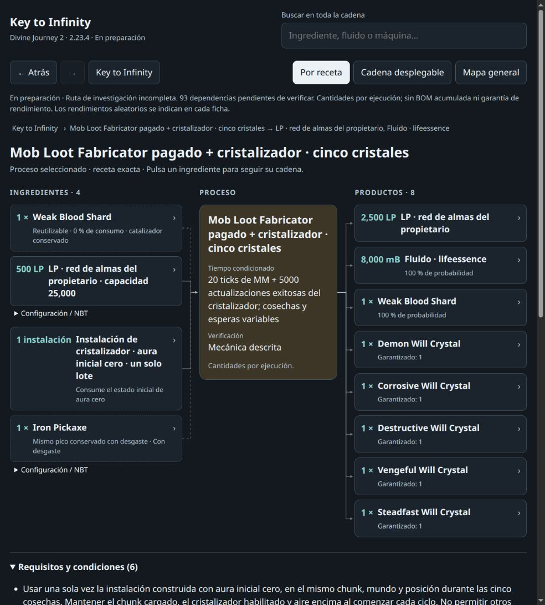

# Key to Infinity · Divine Journey 2 2.23.4

[Open the interactive viewer](https://luisfsandsilva-star.github.io/dj2-key-to-infinity-flowchart/?v=r26) · [Download the offline ZIP](https://github.com/luisfsandsilva-star/dj2-key-to-infinity-flowchart/releases/tag/dj2-2.23.4-preview-20261031-r26)

Public preview **r26**. The selected route has **4 unresolved initial-stock boundaries**, down from five in r25. The map remains incomplete.

- **Full chain to Key** opens the complete selected ingredient chain without a depth or node cap.
- Search any item, fluid or process, then inspect its recipe and ingredient branches.
- Choose 1–100 hops or Full chain. Compact OR and Pending branches preserve the current viewport.
- Focus fades nodes outside the selected connections. Icons, labels and connections remain visible farther out; icon animation can be toggled.
- The quantity planner uses whole recipe batches, retained tools, selected alternatives and stated yields. Inventory progress stays in the current browser.

This update adds the native Enchanter batch: **8 Iron Ingots + 1 Nether Star → 8 Evil Infused Iron Ingots**, costing **64,000 FE** over **1,600 active ticks** at normal speed. The existing paid Enchanter and fifteen Bookshelves are retained. Evil Infused Iron is metadata 17; Demon Ingot is metadata 11 and remains a different ingredient.

The selected iodine route now dissolves Evil Infused Iron into Lead Iodide, then dissolves that into Iodine. The Lead Iodide outcome has a 50% chance. No fixed number of attempts guarantees it. This alternative removes the selected first-Bohrium cycle while keeping all other ingredient, power and operating requirements.

Remaining selected boundaries: Full ProjectE Knowledge, Dimensional Shard Ore, Electrotine Ore and Perfectium Ball. Candidate recipes remain inspectable. An explicit initial-stock boundary requires an actual source or actual owned stock; a connected cycle does not supply its own first item.

Selected route: **5,747 resources** and **2,498 verified recipes**. Full ingredient graph: **5,611 nodes**, **10,226 connections**, **4 unresolved boundaries** and **4 structural cycle groups**. A structural cycle does not imply that every member is unobtainable. The catalogue and selected route have different scopes.

Selected recipe bodies, native ingredient matching, strict route ordering, full graph traversal, offline data reconstruction and all four ZIP members were checked. Native random outcomes, finite rewards, world access and machine conditions remain explicit. Build stages run in series with bounded memory. This update uses the saved successful pack extraction; no new Minecraft execution or visual browser pass was performed.

Extract the ZIP and open `index.html` for offline use. `viewer-data.json.gz` contains the same complete filtered data; `status.json` records counts and hashes; `README.txt` contains offline instructions. Protected narrative content, raw snapshots, mod binaries, worlds and personal configuration are excluded.

Original pack: [Divine Journey 2 2.23.4](https://github.com/Divine-Journey-2/Divine-Journey-2/releases/tag/2.23.4). Mod names and content belong to their respective authors.
