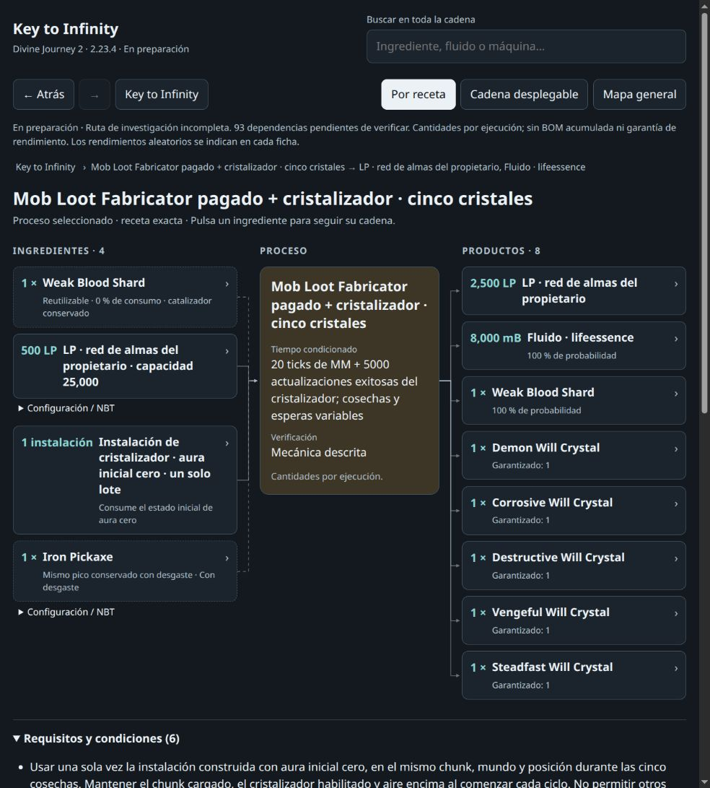

# Key to Infinity · Divine Journey 2 2.23.4

[**Open the interactive diagram**](https://luisfsandsilva-star.github.io/dj2-key-to-infinity-flowchart/?v=r20).

**Work in progress.** The core selected route has **14 unresolved boundaries**, 5,329 resource identities and 2,301 selected recipes. The full ingredient graph contains **8,822 nodes and 15,687 connections**, including **125 unresolved resource boundaries and 17 unverified process previews**. These are different scopes; connected previews do not establish that their outputs are obtainable.

The English catalogue contains 43,983 resources and 38,738 processes. Search includes item, fluid and machine icons. The viewer is a single offline HTML file; catalog details, textures and animations decode when needed.

Download the [r20 preview package](https://github.com/luisfsandsilva-star/dj2-key-to-infinity-flowchart/releases/tag/dj2-2.23.4-preview-20261030-r20), extract it and open `index.html` in a modern browser. GitHub displays repository HTML as source; use the live link or the downloaded file.

- **Full chain to Key** opens the objective. Choose **Full chain** for unlimited ingredient depth, or 1–100 hops for a smaller view. Every catalogue item or fluid can be a starting point.
- **Ingredients** follows each selected producer and its required inputs. **Ingredients and uses** adds downstream uses. Byproducts are not extra ingredients.
- **Compact OR** collapses alternative helpers; the inspector retains all advertised choices. **Compact OR** and **Pending branches** preserve zoom, pan and surviving node positions.
- **Dim unrelated** fades nodes outside the selected connection scope. The inspector retains ingredients, quantities, crafting grids and conditions.
- **Whole route / Areas** provide alternate navigation. Groups describe mods and processes, not progression tiers.
- **Material plan** combines shared demand, reusable tools, local owned inventory and selected OR choices. Finite quest rewards and operations keep their owner limits; shortages remain unresolved. CSV export is available.
- **Animate icons** uses native texture animation sheets. Static frames remain available, only visible icons animate, and reduced-motion preferences start static. Base previews and unknown symbols are explicitly identified.

Repeated navigation now keeps at most three ingredient graph contexts and two combined contexts. Evicted graphs rebuild with the same geometry. New calculations and closing the planner cancel previous workers; workers receive calculation fields rather than display/source copies. Unused duplicate ingredient records were removed from presentation data while ingredient quantities, grids and private evidence remain intact. These changes reduce memory retention without limiting chain depth. Animated OR previews also use a bounded decoded-frame cache during generation. An optional WebP codec failure retains the complete APNG with native frames and timing.

This update adds verified catalogue operations for the paid first Demon Heart ritual, the first Dragon fight and separately paid four-crystal respawns. The pack’s enabled EMT behavior supplies a new egg on later actual Dragon kills; each repeat operation pays its own current End Crystal recipe and combat kit, then requires the egg, DE heart and Quark scale pickups and living return. The first fight retains its single-world capacity and earns only its nonportable same-world access receipt.

A joint first RF-dimension expedition can earn native Peaceful and a Silk-harvested shard ore, then pay the native Chisel conversion to metadata 1. It shares the original first empty-descriptor allowance; it does not create a second world allowance. The catalogue also includes conditional Arcanium chest collection in Arcana and natural adult chicken egg laying, with paid supplies and actual owned return. Unknown overall chances remain explicit and initial guaranteed yields remain zero.

Coordinated changes among existing verified recipes remove several circular route choices. The full graph remains uncapped; its counts change with the chosen route. All 110 proposed choices were checked against current candidates with no stale or rejected choices. This is a better verified route, not a claim of global optimality.

Explicit acquisition metadata now preserves the actual item variant, including Rare Earth at metadata 10 and Bat Wing at metadata 15. Original acquisition evidence and payment remain unchanged. Verified item icons take priority over synthetic process placeholders.

Dark Tank capacity upgrades appear separately: 16,000 → 32,000 → 64,000 → 128,000 mB. The exact capacity-only requirement uses eight fresh tanks and seven upgrades: 24 Dark Steel Ingots, 40 Dark Gems and 8 Black Glass blocks, with no fluid. The fresh tank retains its nine-slot shaped grid.

Some first-state dependencies remain open, including the first Stone Pickaxe Head and several endgame material bootstraps. Conditional Rift and expedition attempts may return zero; unknown overall probabilities do not become guaranteed planner yields. Missing resources and unverified processes remain visible.

Per-run amounts are not a complete accumulated bill of materials. Random yields, unknown quantities, durability, finite rewards, actual world access and operating conditions still apply. Inventory and display preferences are stored in the current browser.

The selected route was checked against pinned local extraction from pack 2.23.4: all 2,301 selected recipe bodies are unchanged, all 9,147 selected edges descend strictly, and no partial recipe or unresolved registry entry is admitted as a producer. Offline staged data reconstructs the complete filtered projection exactly. Model, planner, loader and transport checks are automated; this terminal session had no connected browser for a new visual pass.

`index.html` is the self-contained viewer; `viewer-data.json.gz` is its complete filtered data; `status.json` records scope, counts and hashes; `README.txt` contains offline instructions. Protected narrative content, raw snapshots, mod binaries, worlds and personal configuration are excluded.

Original pack: [Divine Journey 2 2.23.4](https://github.com/Divine-Journey-2/Divine-Journey-2/releases/tag/2.23.4). Mod names and content belong to their respective authors.
